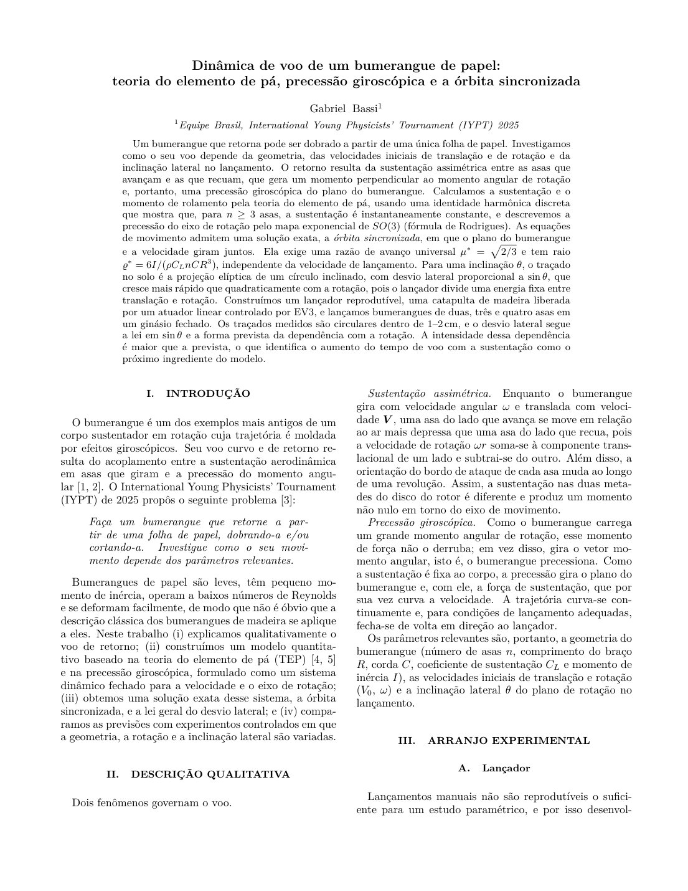
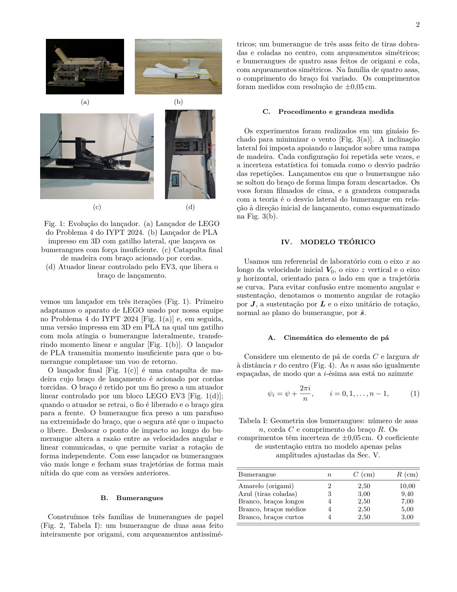
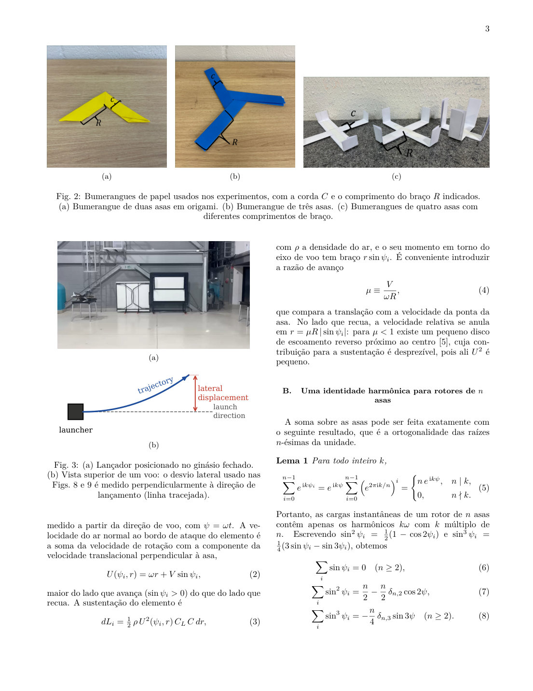
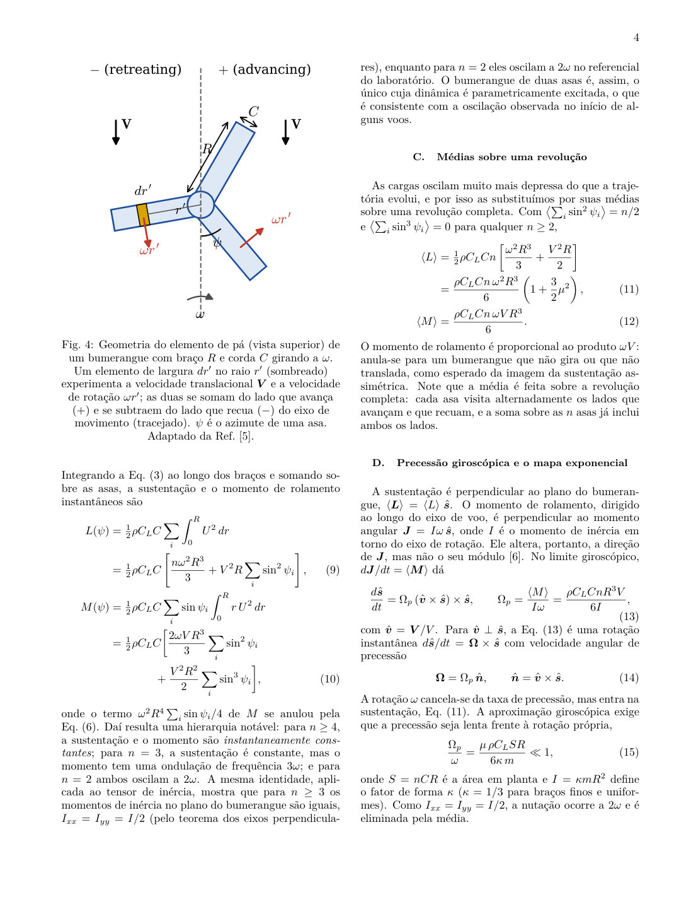
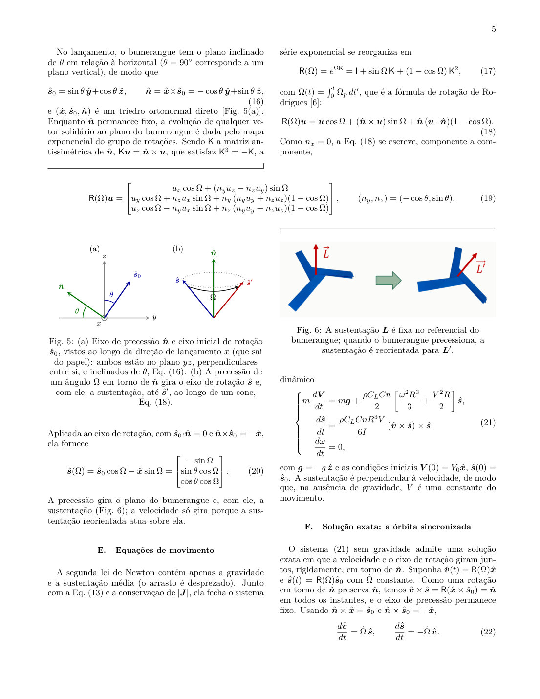
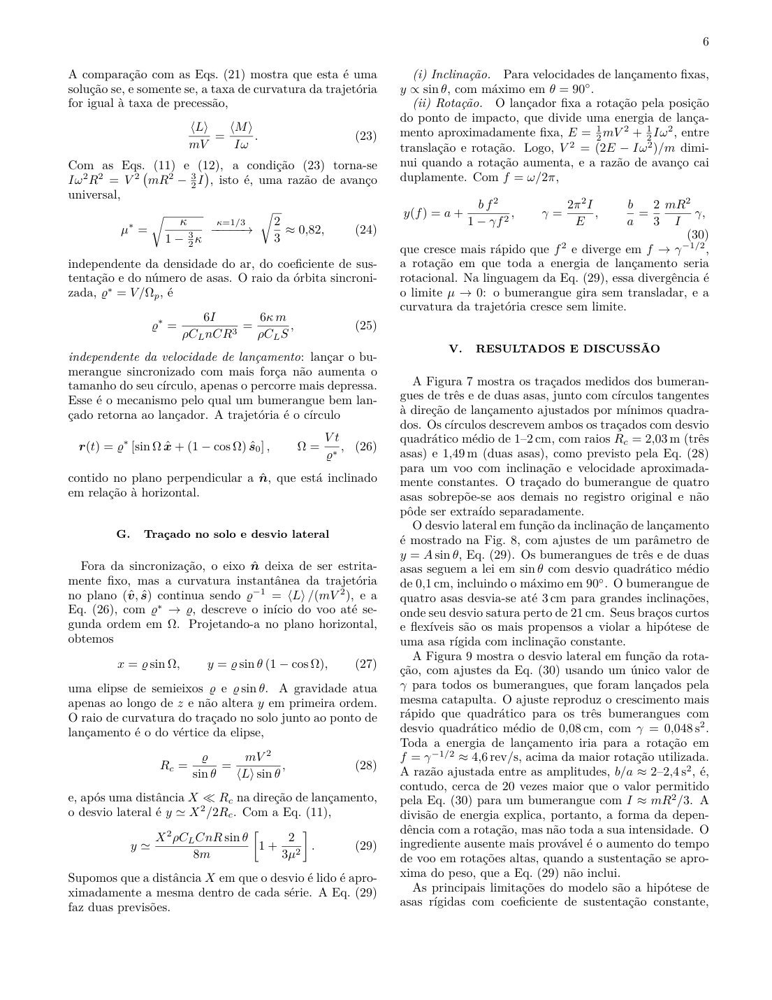
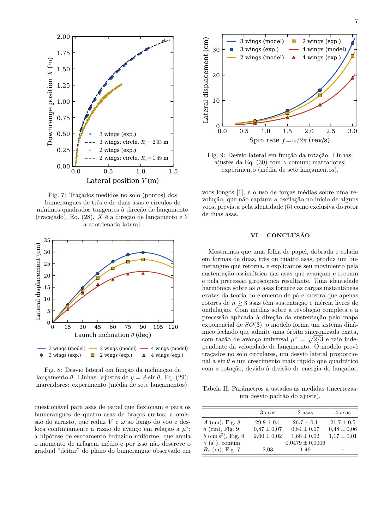
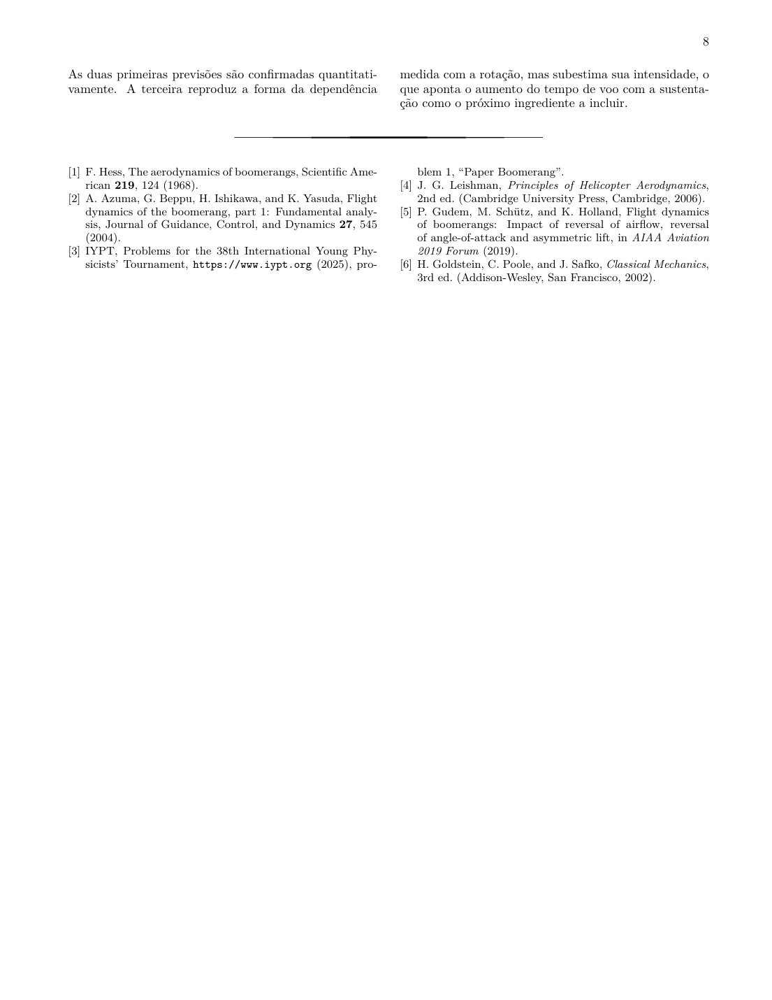

# Dinâmica de voo de um bumerangue de papel

**Teoria do elemento de pá, precessão giroscópica e a órbita sincronizada**

Gabriel Bassi — Equipe Brasil, International Young Physicists' Tournament (IYPT) 2025, Problema 1 ("Paper Boomerang").

**[Ler o artigo online](https://gabrielbassidebm.github.io/bumerangue-de-papel-dinamica-de-voo/)** · [Abrir o PDF](main.pdf) · [Baixar o PDF](https://github.com/GabrielBassiDeBM/bumerangue-de-papel-dinamica-de-voo/raw/main/main.pdf)

## Resumo

Um bumerangue que retorna pode ser dobrado a partir de uma única folha de papel. Este trabalho modela seu voo pela teoria do elemento de pá e pela precessão giroscópica do eixo de rotação $\hat{\boldsymbol s}$, descrita pelo mapa exponencial de $SO(3)$:

$$
\mathsf R(\Omega) = e^{\Omega\mathsf K} = \mathsf I + \sin\Omega\,\mathsf K + (1-\cos\Omega)\,\mathsf K^2 .
$$

As cargas médias sobre uma revolução são

$$
\langle L\rangle = \tfrac12\rho C_L C n\left[\frac{\omega^2R^3}{3}+\frac{V^2R}{2}\right],
\qquad
\langle M\rangle = \frac{\rho C_L C n\,\omega V R^3}{6}.
$$

Os principais resultados teóricos são:

- a identidade harmônica $\sum_{i=0}^{n-1} e^{\mathrm{i}k\psi_i} = n\,e^{\mathrm{i}k\psi}$ se $n \mid k$ (e $0$ caso contrário), que mostra que, para $n \geq 3$ asas, a sustentação é instantaneamente constante;
- uma solução exata das equações de movimento, a *órbita sincronizada*, com razão de avanço universal e raio independente da velocidade de lançamento:

$$
\mu^\ast = \sqrt{\frac{\kappa}{1-\tfrac32\kappa}} = \sqrt{\frac23},
\qquad
\varrho^\ast = \frac{6I}{\rho C_L nCR^3};
$$

- um desvio lateral proporcional a $\sin\theta$, que cresce mais rápido que quadraticamente com a rotação:

$$
y(f) = a + \frac{b\,f^2}{1-\gamma f^2}.
$$

As previsões são comparadas com lançamentos reprodutíveis de bumerangues de duas, três e quatro asas, feitos com uma catapulta de madeira liberada por um atuador linear controlado por EV3.

## O artigo

O artigo completo, página a página. Para ler com zoom ou baixar, use os links no topo.










## Arquivos

- `main.tex`: fonte LaTeX (REVTeX 4.2, português)
- `references.bib`: referências
- `figures/`: figuras
- `main.pdf`: artigo compilado
- `paginas/`: páginas do artigo em imagem
- `index.html`: página de leitura (GitHub Pages)

## Compilação

Compile com pdfLaTeX + BibTeX (por exemplo, no Overleaf, enviando o repositório como projeto) ou localmente:

```
pdflatex main && bibtex main && pdflatex main && pdflatex main
```
